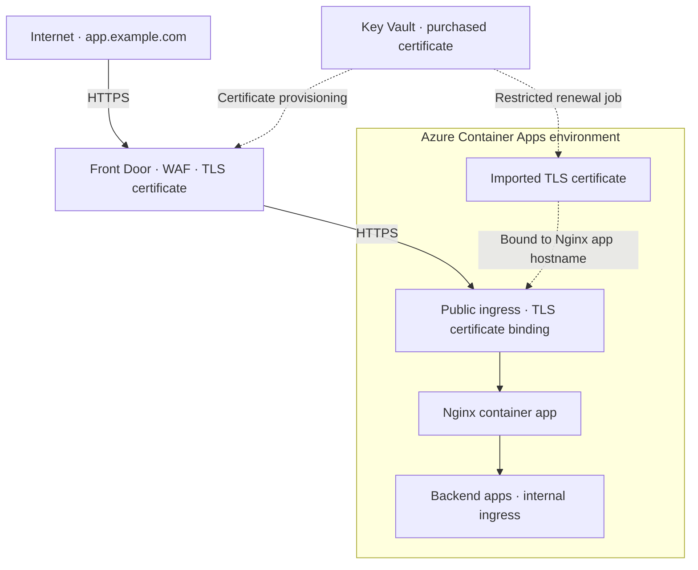
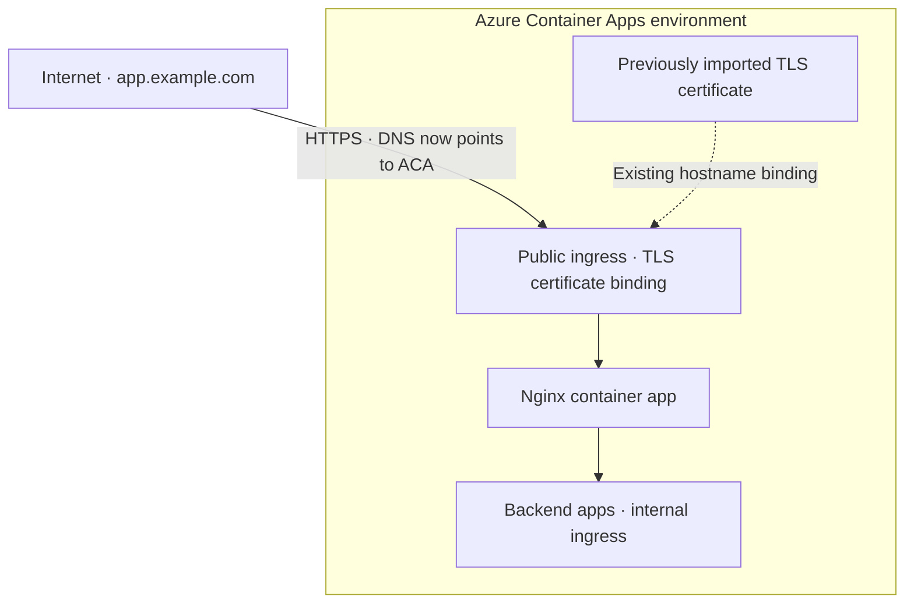

## Why prepare a fallback?

An application can be healthy while its entry point is unavailable. The [Azure Front Door incident on October 29, 2025](https://azure.status.microsoft/status/history/?trackingId=YKYN-BWZ) demonstrated this dependency. The cause can also be internal: a mistake in a team's own Front Door configuration can interrupt access just as effectively as an Azure outage.

For an application behind Front Door, a relatively inexpensive fallback is to point DNS directly to Azure Container Apps (ACA). This requires preparing routing, public access and certificates before the incident. It assumes ACA and the application's dependencies remain available.

## Keep routing close to the application

Front Door normally receives traffic and applies its WAF policies. An Nginx reverse proxy, deployed in ACA, handles paths such as `/backend` and `/admin`.

*Solid arrows show requests; dotted arrows show certificate provisioning.*

The main benefit is that normal traffic continuously exercises the same Nginx routing used during failover. Front Door provides WAF protection and forwards requests; application routing stays in Nginx. This avoids maintaining an unused recovery configuration. Direct access still needs testing: DNS, TLS and forwarded headers differ when Front Door is bypassed.

Only the proxy needs public ingress. Backend apps use internal ingress, which allows access from the same ACA environment; it does not enforce “Nginx only.” Additional controls are needed for that isolation. Without application routing requirements, Nginx can be omitted.

## Prepare HTTPS on both entry points

The public hostname must work on both Front Door and ACA. A certificate managed only by Front Door does not configure HTTPS for direct ACA access.

One approach uses a purchased certificate stored in Key Vault. [Front Door accesses it through a managed identity](https://learn.microsoft.com/en-us/azure/frontdoor/managed-identity). A copy is [imported into the ACA environment and bound to the proxy app's custom hostname](https://learn.microsoft.com/en-us/azure/container-apps/custom-domains-certificates). TLS terminates at ACA ingress, not inside Nginx.

A scheduled job in a dedicated, restricted automation environment distributes renewed certificates to the required ACA environments. Application containers need no Key Vault access for this task. Monitor expiry and verify the renewed certificate served by each entry point.

The certificate is already deployed: switching DNS requires no certificate import or access to Key Vault.

## Switch DNS during an incident

For a subdomain such as `app.example.com`, change its CNAME from the Front Door endpoint to the Nginx container app's generated FQDN.

The URL stays unchanged. This is DNS failover, not an HTTP redirect. DNS caches delay recovery, so choose a suitable TTL beforehand and expect some clients to keep reaching Front Door temporarily.

The proxy must already accept direct public traffic. Restrictions allowing only Front Door would prevent DNS-only recovery. Essential access rules, including restrictions on `/admin`, must also work through Nginx. IP rules must distinguish trusted proxy headers from client-supplied values.

An independently operated DNS provider reduces reliance on Azure management during recovery. Azure CLI still needs the relevant Azure APIs. [Traffic Manager](https://learn.microsoft.com/en-us/azure/traffic-manager/traffic-manager-how-it-works) could automate DNS failover; that variant is untested here.

## Prepare a restricted fallback

A startup script can generate Nginx configuration from environment variables, selecting a maintenance page or IP restrictions. But changing those variables requires an ACA update, which may be unavailable during a wider incident. Prepare the required variants beforehand.

As an alternative to the shared proxy, a normal proxy could accept only verified Front Door traffic, while a separate public fallback proxy blocks `/admin` and other sensitive endpoints. DNS selects the fallback, with the hostname and certificate already bound. Losing administration temporarily may be acceptable in exchange for reducing exposure without a WAF.

Plan hostname routing carefully: [a custom domain binds to one app, route or environment](https://learn.microsoft.com/en-us/azure/container-apps/rule-based-routing-custom-domain). Changing a CNAME alone cannot select between apps sharing one ingress and the same public hostname. Separate environments or distinct origin hostnames need their own routing and authentication tests.

Small proxies can make several prepared scenarios affordable. A standby can [scale to zero](https://learn.microsoft.com/en-us/azure/container-apps/scale-app), but recovery then depends on a successful cold start. Keeping a replica running costs more. Every variant adds maintenance, and a separate fallback loses the benefit of routine production traffic exercising its exact configuration: test it independently. Too many exceptions quickly become difficult to manage.

## Rehearse before relying on it

1. Test Nginx routing locally, then deploy it in ACA.
2. Prepare hostname bindings and certificates. Test direct ACA access with a local override preserving the public hostname and TLS SNI.
3. Use the proxy app's generated ACA FQDN as Front Door's origin destination, not the public hostname that resolves back to Front Door. Verify the [origin Host header](https://learn.microsoft.com/en-us/azure/frontdoor/origin#origin-host-header), TLS validation, application redirects, routing and access restrictions.
4. Switch public DNS to ACA. Check HTTPS, authentication and critical paths.
5. Restore DNS to Front Door and verify recovery.

## Why not Application Gateway?

Application Gateway adds another managed layer and cost to an existing Front Door setup. Nginx can offer a lower-cost option when its operational burden is acceptable; it is not a feature-equivalent replacement.

Any public fallback permits requests that bypass Front Door's WAF, even before a failover. An obscure ACA endpoint is not access control. Nginx requires patching, capacity planning and monitoring, while certificate distribution requires maintenance. This approach fits applications where those trade-offs are acceptable.
